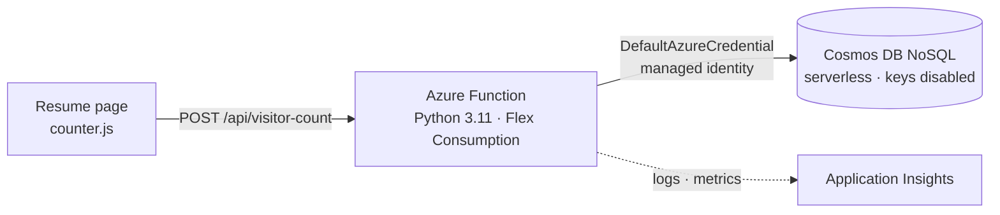

# Cloud Resume Challenge (Azure) — Backend

The visitor counter API for my resume site. Frontend and live site: [resume-frontend](https://github.com/Dlenz4321/resume-frontend).

## Architecture



## API

| Method | Route | Behavior |
|---|---|---|
| `POST` | `/api/visitor-count` | Records a visit and returns the new total, e.g. `{"count": 43}` |
| `GET` | `/api/visitor-count` | Returns the current total without changing it |

The counter is one Cosmos DB document (`{"id": "visitors", "count": N}`), updated with an atomic **patch increment**, so simultaneous visitors can't overwrite each other.

## What's in this repo

```
api/                  Function code (function_app.py = HTTP layer, counter.py = logic)
tests/                pytest unit tests (Cosmos is mocked; no Azure needed)
infra/                Terraform: Cosmos DB, Function App, monitoring, data-role assignment
infra/bootstrap/      One-time script: state storage, pipeline identity, OIDC, GitHub setup
.github/workflows/    terraform.yml (infrastructure) and api.yml (test + deploy)
```

## CI/CD

- **`api.yml`:** every pull request runs the tests. On merge to `main`, tests run again, then deploy waits for my approval and publishes to Flex Consumption with a remote build.
- **`terraform.yml`:** plan on pull requests; apply on merge after approval.

Both sign in to Azure with **OIDC**. There are no secrets in the repo or in GitHub.

## Security decisions

- **No database keys.** Cosmos DB has key-based auth disabled. The Function App's system-assigned managed identity holds the built-in *Cosmos DB Data Contributor* role.
- **Locked-down CORS.** Only the resume site (and the Azure portal, for testing) may call the API from a browser.
- **Errors don't leak details.** Failures return a generic 500, and the full error goes to Application Insights.

## Run the tests locally

```bash
python -m venv .venv
source .venv/Scripts/activate   # Windows Git Bash; use .venv/bin/activate on Mac/Linux
pip install -r requirements-dev.txt
pytest -v
```

## Tech

Azure Functions (Python, Flex Consumption) · Cosmos DB NoSQL (serverless) · Managed identity · Application Insights · Terraform · GitHub Actions · OIDC · pytest

## Known improvements

- Identity-based access for the function's own host storage (it currently uses a storage key)
- Rate limiting on the counter endpoint
